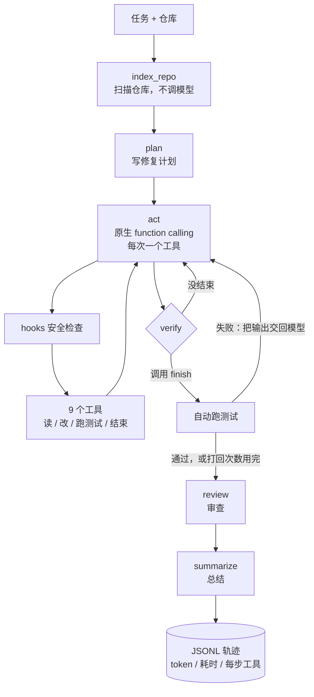

# Coding Agent v2

一个面向代码仓库的 Coding Agent：给它一个仓库和一句任务描述，它会自己读代码、改文件、跑测试，最后审查并总结。

本项目基于开源项目 [Coding-Agent-SFT-Lab](https://github.com/shuailishuaiqiYangLiu/Coding-Agent-SFT-Lab) 二次开发。原项目包含 Agent 和 SFT 训练两部分；本项目只保留 Agent 部分，重做了**工具调用协议、验证闭环、安全边界和评测体系**，并补上了单元测试。逐条改动见 [docs/改进说明.md](docs/改进说明.md)。

## 评测结果

在自建的 12 个任务上（8 个多文件仓库任务 + 4 道 HumanEval 函数题），三种配置各运行 3 次，共 108 次。模型为硅基流动的 `deepseek-ai/DeepSeek-V4.1-Flash`（关闭 thinking，temperature 0.1），最多 10 步，2026-11-09 测量。完整报告见 [eval/results/final_20261109_000831/report.md](eval/results/final_20261109_000831/report.md)。

| 配置 | 总成功率 | 多文件仓库任务 | 函数题 | 因格式问题中止 | 平均 token / 次 | 每个成功任务的 token |
| --- | ---: | ---: | ---: | ---: | ---: | ---: |
| v0 原版：JSON 文本解析 + 规则验证 | 58.3%（21/36） | 37.5%（9/24） | 100%（12/12） | 15 次 | 19.7k | 33.8k |
| v1 + 原生 function calling | **97.2%**（35/36） | **100%**（24/24） | 91.7%（11/12） | **0** | 32.1k | 33.0k |
| v2 + 测试驱动验证（默认配置） | **97.2%**（35/36） | **100%**（24/24） | 91.7%（11/12） | **0** | 30.8k | 31.7k |

怎么读这张表：

- **提升几乎全部来自工具调用协议。** v0 失败的 15 次都是"解析失败、任务中止"，原因也都是同一个：请求里没有 `tools` 参数时，模型会把自己原生的工具调用标记（`<｜DSML｜ invoke …>`）当成普通文本输出，原版的解析器找不到 JSON。换成原生 function calling 后，这类中止降为 0。
- **函数题上没有提升。** 单文件、一两步就能完成的题，原版的协议也够用。v1、v2 各有 1 次在数值算法题 `find_zero` 上用完了 10 步。
- **测试驱动验证在这批任务上没有被触发（打回 0 次）。** 原生模式下，模型都是先跑测试再结束，所以 v2 和 v1 的成功率相同。它的作用是兜底，由单元测试验证（提前 finish 会被打回）。这一项不计入成功率提升。
- **成本。** 多轮消息会累积上下文，单次运行的 token 多了约 60%。但原版有不少任务在前几步就中止了，按"每个成功任务"算，三者都在 3.2 万～3.4 万 token 左右。单次耗时从 16.3 秒增加到 19.0 秒。
- **规模有限。** 只有 12 个任务、每个跑 3 次，而且任务是自建的。DSML 泄漏和具体的模型、服务方有关，换一个模型，原版的表现可能不同。

---

## 相比原版的改动

| 方面 | 原版 | 本项目 |
| --- | --- | --- |
| 工具调用 | 在 prompt 里要求输出 JSON，再用正则解析文本；解析失败任务直接结束 | **原生 function calling**：工具以 JSON Schema 传给接口，模型返回结构化 `tool_calls`，结果以 `tool` 消息回传；参数错误作为观察结果返回，纯文本回复会被提醒继续 |
| 验证 | verify 只按规则判断要不要停，结论模型看不到 | **测试驱动验证**：模型调用 `finish` 后自动跑测试，失败就把输出交回模型继续修，最多打回 2 次 |
| 上下文 | 每步重拼单轮 prompt，只带最近 12 条记录，按字符硬截断 | 多轮消息；单个工具输出保留头尾；超出预算时压缩旧的工具输出，不删消息、不破坏调用与结果的配对 |
| 模型调用 | 只返回文本，thinking 默认开启 | 统一入口：供应商扩展参数配置化（例如关闭 thinking）、记录每次调用的 token 和耗时、超时与指数退避重试 |
| 安全 | 白名单含 `conda run`（可执行任意命令）；按前缀匹配；黑名单大小写失效；能读 `.env`；测试进程继承 API key | 按 token 精确匹配白名单、拒绝 shell 操作符、禁止读写密钥文件、运行测试前清除密钥环境变量 |
| 评测 | 没有任务成功率；批量运行的 `ok` 只表示程序没报错 | 12 个任务、3 种配置逐项叠加的对比实验；恢复原始测试 + 隐藏测试判定成败 |
| 工程质量 | 没有单元测试 | 38 个单元测试，用按剧本回复的假模型覆盖 Agent 主循环，不调用真实模型 |
| 可观测性 | 轨迹里没有 token 和耗时 | 每次模型调用记录 `llm_call` 事件，任务结束记录 `run_summary`，`stats` 命令汇总 |

---

## 架构



| 模块 | 文件 | 作用 |
| --- | --- | --- |
| 主流程 | `src/cc_agent/graph.py` | LangGraph 编排；两种工具协议（`native` / `json`）和两种验证方式（`tests` / `rule`） |
| 模型调用 | `src/cc_agent/llm.py` | OpenAI 兼容接口的统一入口，返回文本、工具调用、token 和耗时 |
| 工具 | `src/cc_agent/tools.py` | 9 个工具的 schema、参数校验和实现 |
| 安全检查 | `src/cc_agent/hooks.py` | 路径越界、命令白名单、密钥文件、环境变量清理 |
| 上下文管理 | `src/cc_agent/context.py` | 工具输出头尾截断、对话超预算时压缩 |
| 仓库索引 | `src/cc_agent/repo_indexer.py` | 文件树、Python 符号、关键词检索 |
| 评测 | `src/cc_agent/evaluation.py`、`eval/` | 任务集、并行运行、判定和报告 |
| 统计 | `src/cc_agent/trace_stats.py` | 汇总轨迹里的 token、耗时和工具调用 |

---

## 快速开始

需要 Python 3.10 以上。

```bash
python3 -m venv .venv
.venv/bin/pip install -r requirements.txt
cp .env.example .env   # 填入 OPENAI_API_KEY
```

`.env` 默认使用硅基流动的 `deepseek-ai/DeepSeek-V4.1-Flash`，也可以换成任何 OpenAI 兼容接口。各家的扩展参数写在 `OPENAI_EXTRA_BODY` 里，例如硅基流动关闭 thinking 是 `{"enable_thinking": false}`，DeepSeek 官方是 `{"thinking": {"type": "disabled"}}`。

运行示例任务（示例仓库里的 `subtract` 函数有 bug）：

```bash
.venv/bin/python run_agent.py run --repo examples/sample_repo --task "修复 subtract 函数的错误实现" --test-command "pytest -q"
```

Agent 会直接修改示例仓库。想再跑一次，先用 `git checkout examples/sample_repo` 恢复。

其他命令：

```bash
.venv/bin/python run_agent.py index --repo examples/sample_repo --query "subtract"   # 看 Agent 拿到的仓库上下文，不调模型
.venv/bin/python run_agent.py stats                                                  # 汇总轨迹：token、耗时、工具调用
.venv/bin/python run_agent.py run ... --tool-mode json --verify-mode rule            # 用原版的协议和验证方式运行
.venv/bin/python -m pytest -q                                                        # 单元测试，不调用真实模型
```

---

## 评测

### 任务集

- **minishop（8 个任务）**：自己写的小型电商代码库，包含定价、优惠券、库存、订单解析、发票、商品目录 8 个模块。往正确代码里注入 bug，每种 bug 是一个任务，覆盖逻辑错误、正则与转义、字符串格式、多处修复、数值精度、跨模块定位、功能实现、大文件定位。
- **函数实现（4 个任务）**：4 道 HumanEval 题。

`eval/build_tasks.py` 生成任务时会做两项校验：正确版本必须通过全部可见测试和隐藏测试（任务可解）；注入 bug 后必须至少有一个可见测试失败（任务不是空的）。这项校验发现原仓库的一道题早已被解好，答案留在了题目文件里，已恢复成原题。

### 判定方式

每次运行都在一个新的临时目录里进行。Agent 结束后，先恢复原始测试文件（防止 Agent 改测试），再放入 Agent 看不到的隐藏测试，全部通过才算成功。

### 三种配置

| 配置 | 工具协议 | 验证方式 | 说明 |
| --- | --- | --- | --- |
| v0 | json | rule | 原版逻辑 |
| v1 | native | rule | 只换成原生 function calling |
| v2 | native | tests | 再加测试驱动验证，即本项目默认配置 |

三种配置共用同一个模型、同一套工具、hooks 和上下文规则，工具描述也用同一套措辞，差别只在协议和验证方式。

### 复现

```bash
.venv/bin/python eval/build_tasks.py                                  # 重新生成并校验任务
.venv/bin/python run_agent.py eval --configs v0,v1,v2 --runs 3 --workers 4
```

报告写在 `eval/results/<时间>/report.md`，每次运行的明细在同目录的 `runs.jsonl`。

---

## 项目结构

```text
.
├── src/cc_agent/          # Agent 源码
├── tests/                 # 单元测试（假模型，不调用真实接口）
├── eval/
│   ├── base_repos/        # 评测用的正确代码库（minishop）和函数题
│   ├── tasks/             # 由 build_tasks.py 生成的任务仓库
│   ├── task_defs.py       # 任务定义：往哪里注入什么 bug
│   ├── build_tasks.py     # 生成并校验任务
│   ├── tasks.json         # 任务清单
│   └── results/           # 评测报告
├── examples/sample_repo/  # 演示用的小仓库
├── docs/
│   ├── 改进说明.md         # 相对原版的逐条改动
│   └── tutorial/          # 学习文档
└── run_agent.py           # 命令行入口
```

---

## 局限与后续

- **任务集规模小。** 只有 12 个任务，都是 Python 小仓库，没有在 SWE-bench 这类真实 issue 上测过。
- **没有沙箱。** hooks 只是第一道防线，pytest 会执行仓库里的代码（例如 `conftest.py`），真正的隔离需要 Docker 沙箱。【设计】
- **上下文只有截断和压缩。** 还没有用模型把早期对话总结成摘要。【设计】
- **review 不能打回。** 审查节点的结论不会让流程回到 act。【设计】
- **检索还是关键词匹配。** 向量检索可以接硅基流动的 `BAAI/bge-m3`，尚未实现。【设计】

---

## 致谢

Agent 的主流程、仓库索引和最初的工具集来自 [Coding-Agent-SFT-Lab](https://github.com/shuailishuaiqiYangLiu/Coding-Agent-SFT-Lab)。
