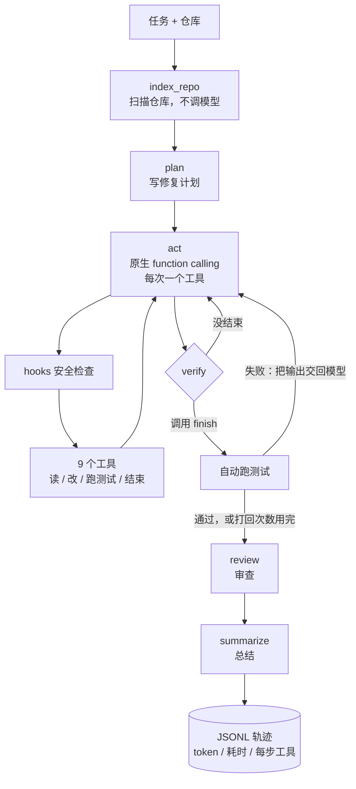

# Coding Agent v2

[](https://github.com/lht030202/coding-agent-v2/actions/workflows/ci.yml)

一个面向代码仓库的 Coding Agent：给它一个仓库和一句任务描述，它会自己读代码、改文件、跑测试，最后审查并总结。

本项目基于开源项目 [Coding-Agent-SFT-Lab](https://github.com/shuailishuaiqiYangLiu/Coding-Agent-SFT-Lab) 二次开发。原项目包含 Agent 和 SFT 训练两部分；本项目只保留 Agent 部分，重做了**工具调用协议、验证闭环、安全边界和评测体系**，并补上了单元测试。逐条改动见 [docs/改进说明.md](docs/改进说明.md)。

## 评测结果

在自建的 12 个任务上（8 个多文件仓库任务 + 4 道 HumanEval 函数题），三种配置各运行 3 次，共 108 次。模型为硅基流动的 `deepseek-ai/DeepSeek-V4.1-Flash`（关闭 thinking，temperature 0.1），最多 10 步，2026-11-09 测量。完整报告见 [eval/results/final_20261109_000831/report.md](eval/results/final_20261109_000831/report.md)。

| 配置 | 总成功率 | 多文件仓库任务 | 函数题 | 因格式问题中止 | 平均 token / 次 | 每个成功任务的 token |
| --- | ---: | ---: | ---: | ---: | ---: | ---: |
| v0 原版：JSON 文本解析 + 规则验证 | 58.3%（21/36） | 37.5%（9/24） | 100%（12/12） | 15 次 | 19.7k | 33.8k |
| v1 + 原生 function calling | **97.2%**（35/36） | **100%**（24/24） | 91.7%（11/12） | **0** | 32.1k | 33.0k |
| v2 + 测试驱动验证（默认配置） | **97.2%**（35/36） | **100%**（24/24） | 91.7%（11/12） | **0** | 30.8k | 31.7k |

怎么读这张表：

- **提升几乎全部来自工具调用协议。** v0 失败的 15 次都是"解析失败、任务中止"，原因也都是同一个：请求里没有 `tools` 参数时，模型会把自己原生的工具调用标记（`<｜DSML｜ invoke …>`）当成普通文本输出，原版的解析器找不到 JSON。换成原生 function calling 后，这类中止降为 0。
- **函数题上没有提升。** 单文件、一两步就能完成的题，原版的协议也够用。v1、v2 各有 1 次在数值算法题 `find_zero` 上用完了 10 步。
- **测试驱动验证在这批任务上没有被触发（打回 0 次）。** 原生模式下，模型都是先跑测试再结束，所以 v2 和 v1 的成功率相同。它的作用是兜底，由单元测试验证（提前 finish 会被打回）。这一项不计入成功率提升。换成更弱的 Qwen3-8B 后，它第一次真正触发（见补充实验 A）。
- **成本。** 多轮消息会累积上下文，单次运行的 token 多了约 60%。但原版有不少任务在前几步就中止了，按"每个成功任务"算，三者都在 3.2 万～3.4 万 token 左右。单次耗时从 16.3 秒增加到 19.0 秒。
- **规模有限。** 只有 12 个任务、每个跑 3 次，而且任务是自建的。DSML 泄漏和具体的模型有关：换成千问（Qwen3-8B、Qwen3.8-27B）后，原版的格式中止只有 0～1 次，三种配置的差距也小得多（见补充实验 A、D）。

### 补充实验（2026-11-09）

主评测里有几个机制在真实运行中没派上用场：测试驱动验证打回 0 次，上下文压缩 0 次，检索工具 0 次调用。为此补做了三组实验（A–C）；之后又换了一个更强的千问模型，把三种配置完整重跑一遍（D），看主评测的结论换个模型还成不成立。A–C 三组同时运行，D 用 2 个并发并带重试，耗时数字都不能和主评测比，下面只比较成功率、token 和步数。

**A. 换模型：Qwen3-8B（关闭 thinking），三种配置 × 12 个任务 × 3 次。** 完整报告见 [supp_qwen3_8b/…/report.md](eval/results/supp_qwen3_8b/20261109_125542/report.md)。

| 配置 | 总成功率 | 多文件仓库任务 | 函数题 | 因格式问题中止 | 10 步用完 | 平均 token / 次 |
| --- | ---: | ---: | ---: | ---: | ---: | ---: |
| v0 原版 | 22.2%（8/36） | 3/24 | 5/12 | 0 | 27 次 | 49.7k |
| v1 + 原生 function calling | 36.1%（13/36） | 7/24 | 6/12 | 0 | 20 次 | 47.5k |
| v2 + 测试驱动验证 | 25.0%（9/36） | 2/24 | 7/12 | 0 | 26 次 | 53.3k |

- **主评测里的大幅提升和模型有关。** Qwen3-8B 不会把工具调用标记漏进文本，原版一次格式中止都没有。DeepSeek 上 58% → 97% 的提升，主要来自修掉 DSML 泄漏这个具体问题。
- **原生 function calling 在 Qwen 上仍有改善，但不显著。** 成功率从 22.2% 到 36.1%；原版的 64 次工具报错全是"找不到要替换的原文"，原生模式下这类报错降到 4～12 次。不过每组只有 36 次运行，两组成功率之差的标准差约 11 个百分点，14 个百分点的差距还不能算显著。
- **测试驱动验证第一次真正触发。** v2 里 4 次"测试没过就 finish"全部被打回，其中 1 次修好通过，另外 3 次打回后步数用完。对照组 v1 里同样的情况有 2 次，都直接以失败结束。验证只在 finish 时介入，所以 v2 比 v1 少的 4 次成功来自其他运行的随机波动，不是验证造成的。
- **小模型在这批任务上能力不足。** 大部分失败是 10 步用完；原生模式下还有 7～9 次参数 JSON 写坏，都作为观察结果交回模型，没有中止任务。

**B. 调低上下文预算：DeepSeek V4.1-Flash，v2，预算从 6 万字符降到 2 万字符，12 个任务 × 3 次。** 完整报告见 [supp_budget_20k/…/report.md](eval/results/supp_budget_20k/20261109_125542/report.md)。

| 上下文预算 | 成功率 | 触发压缩的运行 | 平均 token / 次 | 每个成功任务的 token | 平均步数 |
| --- | ---: | ---: | ---: | ---: | ---: |
| 6 万字符（主评测） | 97.2%（35/36） | 0 次 | 30.8k | 31.7k | 4.3 |
| 2 万字符 | 94.4%（34/36） | 10 次 | 34.0k | 35.9k | 4.8 |

- **压缩真正触发后，成功率基本不变。** 多失败的 1 次仍是数值算法题 `find_zero`。
- **但 token 没有省下来。** 整体平均从 30.8k 变成 34.0k。拆开看：没触发压缩的 26 次运行，token 和主评测里同样任务的平均值相同（都是 27.0k）；触发压缩的 10 次运行平均 51.9k，主评测里同样任务是 40.8k。这些运行多走了几步（例如 ms08 有一次从 5 步拖到 10 步），完全相同的重复读取也从约 0.7 次增加到 3 次。
- **结论：** 在这批平均 4～5 步的短任务上，压缩省不了 token。它的价值在于长任务里防止上下文超出模型窗口，这批任务没有覆盖到。
- **事后发现的问题（已修复）：** 报告里的压缩计数是 38，但同一条消息会被重复计数，这个数偏高。原因是压缩后的消息会写回对话，而"预览 + 标记"仍超过 400 字符的阈值，后面每一步都会再压一次、再计一次数；每压一次还会在预览末尾叠加一个标记，把原来保留的尾部内容挤掉。现在已压缩过的消息不再处理（改进说明第 5 条）。B 是修复前跑的，模型能看到的旧输出比修复后少，多出来的重复读取可能有一部分来自这里。

**C. 大文件读取：read_file 改为按行分页后（改进说明第 8 条），复跑大文件任务 ms08，v2 × 3 次。** 完整报告见 [supp_readfile_ms08/…/report.md](eval/results/supp_readfile_ms08/20261109_130149/report.md)。

| ms08 | 成功 | 平均 token / 次 | 平均步数 | read_file 怎么读 |
| --- | ---: | ---: | ---: | --- |
| 改之前（主评测 v2） | 3/3 | 47.0k | 5.0 | 先试 limit 3000、4000，再要 20000；拿到 15k 字符，中间却被截掉 |
| 改之后 | 3/3 | **31.2k** | **4.0** | 按符号索引给出的行号，一次读第 270–330 行 |

样本只有 3 次，但三次表现一致：模型直接拿仓库上下文里符号索引的"文件:行号"去读那一段，每次运行的 token 降了约三分之一。

**D. 换更强的千问：Qwen3.8-27B（关闭 thinking），三种配置 × 12 个任务 × 3 次。** 完整报告见 [supp_qwen38_27b/merged_…/report.md](eval/results/supp_qwen38_27b/merged_20261109_171132/report.md)。这一轮的代码已包含 C 里的 read_file 分页，这一点和主评测、A 不同。中途账户余额不足，88 次运行报接口错误；已完成的 20 次保留，缺失的 88 次用相同的代码和设置补跑后合并（`eval/fill_errored_runs.py`）。

| 配置 | 总成功率 | 多文件仓库任务 | 函数题 | 因格式问题中止 | 10 步用完 | 平均 token / 次 |
| --- | ---: | ---: | ---: | ---: | ---: | ---: |
| v0 原版 | 91.7%（33/36） | 24/24 | 9/12 | 1 次 | 5 次 | 27.9k |
| v1 + 原生 function calling | 94.4%（34/36） | 24/24 | 10/12 | 0 | 2 次 | 27.3k |
| v2 + 测试驱动验证 | 91.7%（33/36） | 24/24 | 9/12 | 0 | 3 次 | 29.5k |

- **主评测里协议带来的大幅提升，换到 Qwen3.8-27B 上基本消失。** 这个模型用 JSON 文本协议也很稳：36 次里只有 1 次格式错误，而且发生在代码已经改好之后，结果仍判为成功。三种配置的成功率最多相差 1 次，在随机波动范围内。原生 function calling 消除的是"格式解析失败"这一类故障，收益大小取决于模型出这类故障有多频繁：DeepSeek 上很大（58% → 97%），Qwen3.8-27B 上几乎没有。
- **失败集中在一道函数题。** 8 个多文件仓库任务三种配置全部通过。8 次失败里 7 次是 `make_palindrome`（fn01）：模型写的实现反复过不了可见测试，最后 10 步用完；另 1 次是 `find_zero`。这是模型解题能力的问题，协议和验证都帮不上。
- **测试驱动验证仍然打回 0 次。** 每次 finish 之前都有一次通过的测试运行；hooks 拦截、上下文压缩也都是 0 次。
- **从轨迹里发现一处工具说明不一致（已修复）。** v0 在大文件任务 ms08 上平均 66.8k token，v1/v2 只要 29.3k，而且 3 次里有 2 次把 10 步用完。查轨迹发现：C 里只给原生工具定义加了 `start_line`，v0 的文本协议说明没有写。分页提示（"Read on with start_line=118"）在 read_file 输出的末尾，可原版每步重拼 prompt 时，每条工具输出只保留前 1800 个字符，提示正好被截掉。模型不知道还能按行读，只能反复读第一页、反复 grep。在说明里补上这个可选参数后，复跑 v0 × ms08 × 3 次（[报告](eval/results/supp_qwen38_27b/v0_ms08_doc_fix/20261109_171418/report.md)）：

| v0 × ms08 | 成功 | 平均 token / 次 | 平均步数 | 10 步用完 |
| --- | ---: | ---: | ---: | ---: |
| 文本说明里没写 `start_line` | 3/3 | 66.8k | 9.3 | 2 次 |
| 补上之后 | 3/3 | **25.9k** | **4.0** | 0 |

三次都在第一步就按符号索引给出的行号，直接读 `price_range` 附近（两次第 285–320 行，一次第 300–320 行）。工具输出可能被截断，写在输出里的提示不一定能被模型看到，参数必须写进工具说明。把这 3 次换成复跑结果后，v0 平均每次 24.5k token，比 v1/v2 还略低，因为原版每步重拼单轮 prompt，不累积多轮消息。

**附：主评测里各机制在真实运行中触发了几次**（原生模式 v1 + v2，共 72 次运行）

| 机制 | 次数 | 说明 |
| --- | ---: | --- |
| hooks 拦截 | 15 | 全是模型想借 `run_tests` 执行 `python -c` 临时脚本，被白名单拦下 |
| 工具输出头尾截断 | 6 | 都在大文件任务 ms08，促成了上面的 C |
| 测试驱动验证打回 | 0 | 每次 finish 之前，模型都在最后一次修改之后跑过通过的测试；验证补跑的测试也全部通过 |
| 上下文压缩 | 0 | 单次调用最长约 9.8k token，没到预算 |
| retrieve_context | 0 | 规划前预取的仓库上下文已经够用 |

---

## 相比原版的改动

| 方面 | 原版 | 本项目 |
| --- | --- | --- |
| 工具调用 | 在 prompt 里要求输出 JSON，再用正则解析文本；解析失败任务直接结束 | **原生 function calling**：工具以 JSON Schema 传给接口，模型返回结构化 `tool_calls`，结果以 `tool` 消息回传；参数错误作为观察结果返回，纯文本回复会被提醒继续 |
| 验证 | verify 只按规则判断要不要停，结论模型看不到 | **测试驱动验证**：模型调用 `finish` 后自动跑测试，失败就把输出交回模型继续修，最多打回 2 次 |
| 上下文 | 每步重拼单轮 prompt，只带最近 12 条记录，按字符硬截断 | 多轮消息；单个工具输出保留头尾；超出预算时压缩旧的工具输出，不删消息、不破坏调用与结果的配对；read_file 按行分页，大文件的中间部分也能读到 |
| 模型调用 | 只返回文本，thinking 默认开启 | 统一入口：供应商扩展参数配置化（例如关闭 thinking）、记录每次调用的 token 和耗时、超时与指数退避重试 |
| 安全 | 白名单含 `conda run`（可执行任意命令）；按前缀匹配；黑名单大小写失效；能读 `.env`；测试进程继承 API key | 按 token 精确匹配白名单、拒绝 shell 操作符、禁止读写密钥文件、运行测试前清除密钥环境变量 |
| 评测 | 没有任务成功率；批量运行的 `ok` 只表示程序没报错 | 12 个任务、3 种配置逐项叠加的对比实验；恢复原始测试 + 隐藏测试判定成败 |
| 工程质量 | 没有单元测试 | 43 个单元测试，用按剧本回复的假模型覆盖 Agent 主循环，不调用真实模型；GitHub Actions 在 Python 3.10 和 3.12 上自动运行代码检查和全部测试 |
| 可观测性 | 轨迹里没有 token 和耗时 | 每次模型调用记录 `llm_call` 事件，任务结束记录 `run_summary`，`stats` 命令汇总 |

---

## 架构



| 模块 | 文件 | 作用 |
| --- | --- | --- |
| 主流程 | `src/cc_agent/graph.py` | LangGraph 编排；两种工具协议（`native` / `json`）和两种验证方式（`tests` / `rule`） |
| 模型调用 | `src/cc_agent/llm.py` | OpenAI 兼容接口的统一入口，返回文本、工具调用、token 和耗时 |
| 工具 | `src/cc_agent/tools.py` | 9 个工具的 schema、参数校验和实现 |
| 安全检查 | `src/cc_agent/hooks.py` | 路径越界、命令白名单、密钥文件、环境变量清理 |
| 上下文管理 | `src/cc_agent/context.py` | 工具输出头尾截断、对话超预算时压缩 |
| 仓库索引 | `src/cc_agent/repo_indexer.py` | 文件树、Python 符号、关键词检索 |
| 评测 | `src/cc_agent/evaluation.py`、`eval/` | 任务集、并行运行、判定和报告 |
| 统计 | `src/cc_agent/trace_stats.py` | 汇总轨迹里的 token、耗时和工具调用 |

---

## 快速开始

需要 Python 3.10 以上。

```bash
python3 -m venv .venv
.venv/bin/pip install -r requirements.txt
cp .env.example .env   # 填入 OPENAI_API_KEY
```

`.env` 默认使用硅基流动的 `deepseek-ai/DeepSeek-V4.1-Flash`，也可以换成任何 OpenAI 兼容接口。各家的扩展参数写在 `OPENAI_EXTRA_BODY` 里，例如硅基流动关闭 thinking 是 `{"enable_thinking": false}`，DeepSeek 官方是 `{"thinking": {"type": "disabled"}}`。

运行示例任务（示例仓库里的 `subtract` 函数有 bug）：

```bash
.venv/bin/python run_agent.py run --repo examples/sample_repo --task "修复 subtract 函数的错误实现" --test-command "pytest -q"
```

Agent 会直接修改示例仓库。想再跑一次，先用 `git checkout examples/sample_repo` 恢复。

其他命令：

```bash
.venv/bin/python run_agent.py index --repo examples/sample_repo --query "subtract"   # 看 Agent 拿到的仓库上下文，不调模型
.venv/bin/python run_agent.py stats                                                  # 汇总轨迹：token、耗时、工具调用
.venv/bin/python run_agent.py run ... --tool-mode json --verify-mode rule            # 用原版的协议和验证方式运行
.venv/bin/python -m pytest -q                                                        # 单元测试，不调用真实模型
```

---

## 评测

### 任务集

- **minishop（8 个任务）**：自己写的小型电商代码库，包含定价、优惠券、库存、订单解析、发票、商品目录 8 个模块。往正确代码里注入 bug，每种 bug 是一个任务，覆盖逻辑错误、正则与转义、字符串格式、多处修复、数值精度、跨模块定位、功能实现、大文件定位。
- **函数实现（4 个任务）**：4 道 HumanEval 题。

`eval/build_tasks.py` 生成任务时会做两项校验：正确版本必须通过全部可见测试和隐藏测试（任务可解）；注入 bug 后必须至少有一个可见测试失败（任务不是空的）。这项校验发现原仓库的一道题早已被解好，答案留在了题目文件里，已恢复成原题。

### 判定方式

每次运行都在一个新的临时目录里进行。Agent 结束后，先恢复原始测试文件（防止 Agent 改测试），再放入 Agent 看不到的隐藏测试，全部通过才算成功。

### 三种配置

| 配置 | 工具协议 | 验证方式 | 说明 |
| --- | --- | --- | --- |
| v0 | json | rule | 原版逻辑 |
| v1 | native | rule | 只换成原生 function calling |
| v2 | native | tests | 再加测试驱动验证，即本项目默认配置 |

三种配置共用同一个模型、同一套工具、hooks 和上下文规则，工具描述也用同一套措辞，差别只在协议和验证方式。（主评测之后，read_file 加了行范围参数，原生工具定义和 v0 的文本说明里都写了，见改进说明第 8 条。）

### 复现

```bash
.venv/bin/python eval/build_tasks.py                                  # 重新生成并校验任务
.venv/bin/python run_agent.py eval --configs v0,v1,v2 --runs 3 --workers 4
```

报告写在 `eval/results/<时间>/report.md`，每次运行的明细在同目录的 `runs.jsonl`。

评测中途因接口错误（限流、余额不足）中断时，不必整轮重跑：只补跑缺失的任务和配置，再用 `eval/fill_errored_runs.py <中断的结果> <补跑的结果>…` 合并。每个任务、每种配置的运行次数对不上时，脚本会拒绝生成报告。

---

## 项目结构

```text
.
├── src/cc_agent/          # Agent 源码
├── tests/                 # 单元测试（假模型，不调用真实接口）
├── .github/workflows/     # CI：ruff 代码检查 + 单元测试
├── eval/
│   ├── base_repos/        # 评测用的正确代码库（minishop）和函数题
│   ├── tasks/             # 由 build_tasks.py 生成的任务仓库
│   ├── task_defs.py       # 任务定义：往哪里注入什么 bug
│   ├── build_tasks.py     # 生成并校验任务
│   ├── merge_results.py   # 用重跑的任务替换主评测里的同名任务
│   ├── fill_errored_runs.py  # 补齐因接口错误中断的评测
│   ├── tasks.json         # 任务清单
│   └── results/           # 评测报告
├── examples/sample_repo/  # 演示用的小仓库
├── docs/
│   └── 改进说明.md         # 相对原版的逐条改动
└── run_agent.py           # 命令行入口
```

---

## 局限与后续

- **任务集规模小。** 只有 12 个任务，都是 Python 小仓库，没有在 SWE-bench 这类真实 issue 上测过。每组 36 次运行，十个百分点左右的差异仍在随机波动范围内。
- **长任务没覆盖到。** 任务平均只有 4～5 步，上下文压缩和检索工具的价值体现不出来（补充实验 B）。
- **没有沙箱。** hooks 只是第一道防线，pytest 会执行仓库里的代码（例如 `conftest.py`），真正的隔离需要 Docker 沙箱。【设计】
- **上下文只有截断和压缩。** 还没有用模型把早期对话总结成摘要。【设计】
- **review 不能打回。** 审查节点的结论不会让流程回到 act。【设计】
- **检索还是关键词匹配。** 向量检索可以接硅基流动的 `BAAI/bge-m3`，尚未实现。【设计】

---

## 致谢

Agent 的主流程、仓库索引和最初的工具集来自 [Coding-Agent-SFT-Lab](https://github.com/shuailishuaiqiYangLiu/Coding-Agent-SFT-Lab)。
